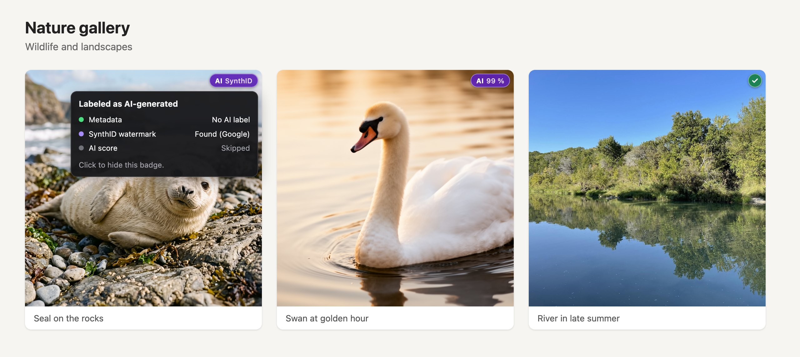

# AI Watermark

[](https://github.com/s-gehring/ai-watermark-addon/actions/workflows/ci.yml)
[](LICENSE)
[](https://www.mozilla.org/firefox/)

A Firefox add-on that checks images on web pages for signs of AI generation and marks hits with a small badge. Everything runs locally in the browser: no image leaves your computer, and there is no API and no server.



<sub>Seal (Gemini 3.1 Flash Image) and swan (FLUX.2) from [bigdatamark/synthid-research](https://huggingface.co/datasets/bigdatamark/synthid-research), metadata removed. River photo from [DOCCI](https://huggingface.co/datasets/google/docci) by Google, CC BY 4.0.</sub>

## What it checks

Every image whose shorter side is at least 200 px goes through up to three checks. The first one that finds something decides the badge.

| Check | Looks for | Badge |
|---|---|---|
| **Metadata** | AI labels in C2PA manifests and IPTC/XMP, generation parameters from Stable Diffusion, ComfyUI, NovelAI and InvokeAI, the Chinese AIGC label (GB 45438-2025) | AI · Metadata |
| **SynthID watermark** | the invisible watermark that Google (Gemini, Imagen) and, since May 2026, OpenAI (ChatGPT, API) embed in generated images, measured in the pixels | AI · SynthID |
| **Model** | a ViT classifier (Detectra fine-tuned on OpenFake) run with ONNX Runtime Web | AI 97 % |

There is no public SynthID detector. The add-on reconstructs a fixed part of the watermark from public sample images and compares image spectra against it. [docs/how-it-works.md](docs/how-it-works.md) explains all three checks.

## How well it works

- **Model:** at the default threshold it flags about 1 % of real photos and detects about half of all AI images under web conditions (downscaled and JPEG-compressed): 54–65 % from OpenFake and AI subreddits, 34–40 % from the newest generators (FLUX.2, GPT-Image 2, Qwen-Image 2.1, Gemini 3.1). It flagged none of 156 museum paintings, 5–7 % of WikiArt paintings and no charts.
- **SynthID:** detects 95 % of Gemini 3.1 images as delivered and 75–94 % of ChatGPT images in the four supported output sizes. False positives are rare: the Google template triggered on 1 of about 1,700 real photos, the OpenAI templates on none of about 1,900 images without the watermark. Cropping destroys the signal and recompression weakens it.
- **Metadata:** reliable when present, but many platforms strip metadata on upload.

The badge is a hint, not proof. Full numbers and limitations are in [docs/accuracy.md](docs/accuracy.md).

## Install

The add-on is not on addons.mozilla.org yet. To try it, [build it from source](#build-from-source) and load `dist/manifest.json` via `about:debugging` → "This Firefox" → "Load Temporary Add-on…". For a permanent install, see [docs/development.md](docs/development.md#install-permanently).

Requires Firefox 140 or later, or Firefox for Android 142 or later.

## Usage

Every checked image gets a symbol in its top right corner:

| Symbol | Meaning |
|---|---|
| dark circle with spinner | being checked |
| purple "AI 97 %" or "AI · Metadata" | likely AI-generated, or AI-generated according to its metadata |
| purple "AI · SynthID" | SynthID watermark (Google or OpenAI) found in the pixels or the C2PA manifest |
| green check mark | checked, nothing found |
| grey "?" | could not be checked (download, format or aspect ratio) |

- **Toolbar button:** number of AI images on the page; while checks are running, the icon is dimmed and shows a progress bar.
- **Popup:** progress ("Checking images: 12 of 30"), counters for unremarkable and uncheckable images, switches to turn the add-on off globally or per site.
- **Hover a symbol:** a panel shows the result of every check (metadata, SynthID watermark, model score with threshold).
- **Click a symbol:** hides it.
- **Settings** (popup → Settings, or via `about:addons`): minimum image size, model threshold, metadata check, SynthID check, CSS background images, percentage display, symbols for unremarkable images and running checks, disabled sites.

## Privacy and permissions

- All checks run locally in a Web Worker. The add-on sends no data to any third party and has no telemetry.
- To read the original bytes of images from other domains, the add-on fetches each image a second time from the same URL, usually served from the browser cache.
- `<all_urls>` is needed to find and fetch images on any page, `storage` to keep your settings.

## Build from source

Requires Node 22.

```bash
npm ci
npm run fetch-model   # downloads the model weights (44 MB) from Hugging Face and verifies the checksum
npm run build         # builds to dist/
npm start             # starts Firefox with the add-on
```

Tests, linting, packaging, model evaluation and training, and rebuilding the SynthID templates are described in [docs/development.md](docs/development.md).

## Project structure

```
src/background/   image download, cache, tab statistics and toolbar icon; worker with metadata scan, SynthID check, preprocessing and model
src/content/      image discovery (IntersectionObserver, MutationObserver) and badge overlay in a shadow DOM
src/popup/        toolbar popup
src/options/      settings page
model.json        model, input format, calibration, default threshold
synthid.json      source, size, scaling and threshold of the SynthID templates (src/background/synthid-templates/)
tools/eval/       test data download and model comparison
tools/train/      model fine-tuning (data download, training, ONNX export)
tools/synthid/    reference implementation, template building and measurement of the SynthID check
```

## Contributing

Bug reports, false positives and missed AI images are welcome as [issues](https://github.com/s-gehring/ai-watermark-addon/issues). See [CONTRIBUTING.md](CONTRIBUTING.md) before opening a pull request.

## License

The code is licensed under the [MIT License](LICENSE).

The bundled model weights are licensed under [CC BY-NC 4.0](https://creativecommons.org/licenses/by-nc/4.0/) because they are trained on OpenFake. **A built add-on may therefore only be used and redistributed non-commercially.** [THIRD_PARTY_NOTICES.md](THIRD_PARTY_NOTICES.md) lists all third-party components, their licenses and the required attributions.

This project is not affiliated with Google, OpenAI or the C2PA.

## Acknowledgements

- [Detectra](https://huggingface.co/TensorFold/detectra-v1) by TensorFold and [Community Forensics](https://huggingface.co/OwensLab/commfor-model-384) by Jeongsoo Park and Andrew Owens, the base models
- [OpenFake](https://huggingface.co/datasets/ComplexDataLab/OpenFake) by the Complex Data Lab, for fine-tuning and evaluation
- [bigdatamark/synthid-research](https://huggingface.co/datasets/bigdatamark/synthid-research), [winrisef/gpt-generated-image-collection](https://huggingface.co/datasets/winrisef/gpt-generated-image-collection) and [aoxo/reverse-synthid](https://huggingface.co/datasets/aoxo/reverse-synthid), the sources of the SynthID templates
- [ONNX Runtime Web](https://github.com/microsoft/onnxruntime), which runs the model in the browser
